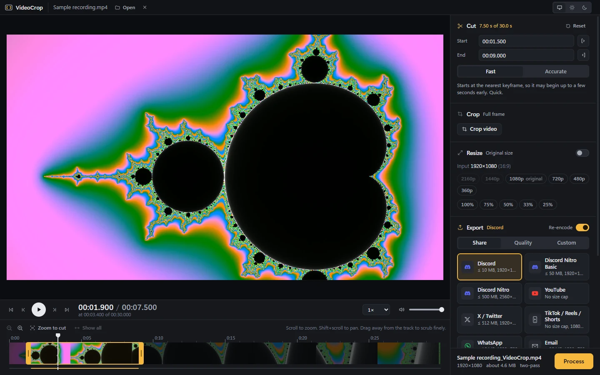
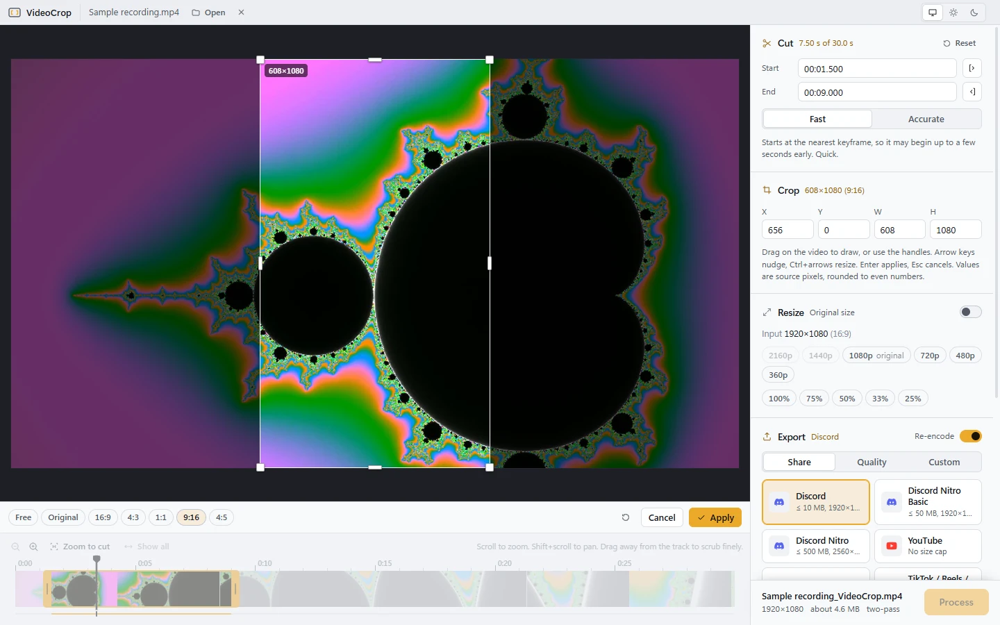

<div align="center">


# VideoCrop

**Cut, crop, resize and compress videos on Windows: fast, tiny and free.**

[](https://github.com/Azmekk/VideoCrop/releases/latest)
[](https://github.com/Azmekk/VideoCrop/actions/workflows/ci.yml)

[](https://github.com/Azmekk/VideoCrop/releases)

[**Download**](https://github.com/Azmekk/VideoCrop/releases/latest) · [Features](#features) · [FAQ](#faq) · [Building](#building-from-source)



</div>

Drop in a clip, trim it, crop it, pick where it's going (Discord, YouTube, …) and hit **Process**. VideoCrop handles the codec, bitrate and resolution, and that includes making a gameplay clip fit under Discord's 10 MB limit.

## Features

<table>
<tr>
<td width="50%" valign="top">

### ✂️ Cut
A zoomable timeline with filmstrip thumbnails. Scroll to zoom right down to individual frames. While scrubbing, drag away from the track to slow down for fine control. Or type exact times. Cuts can be frame-accurate or instant (keyframe-snapped).

### 🔲 Crop
Crop on a full-resolution still with handles, rule-of-thirds guides and one-click aspects (16:9, 4:3, 1:1, 9:16, 4:5, original). Preview the cropped result live.

### ↔️ Resize
Aspect-locked width and height, presets that never upscale past your source, and quick 75/50/25% options.

</td>
<td width="50%" valign="top">

### 📤 Share presets
One click for **Discord** (10 MB, Nitro 50 / 500 MB), **YouTube**, **X**, **TikTok / Reels / Shorts**, **WhatsApp** and **email**. Size caps are hit with two-pass encoding, and the resolution is picked automatically so the clip still looks good.

### 🎚️ Full control when you want it
Quality presets for H.264, H.265 and AV1, plus a custom panel: codec, CRF, target bitrate or target file size, speed, audio codec, 10-bit. You can also extract just the audio or just the video.

### ▶️ Plays everything
Multi-hour OBS recordings in HEVC, AV1 or MKV open instantly. Anything Windows can't decode is streamed through an on-demand preview, so there's no conversion step up front.

</td>
</tr>
</table>

<div align="center">

<br><sub>Crop mode in the light theme</sub>
</div>

## Download

Get the latest version from the [**Releases page**](https://github.com/Azmekk/VideoCrop/releases/latest):

| File | What it is |
|---|---|
| `VideoCrop-vX.Y.Z-x64-setup.exe` | **Installer (recommended).** About 2 MB. Per-user, no admin rights, Start menu entry and uninstaller. |
| `VideoCrop-vX.Y.Z-x64-portable.exe` | A single exe. Run it from anywhere. |
| `…-arm64-…` | The same, for Windows on ARM. |

**Requirements:** Windows 10 (1809) or 11, with the WebView2 runtime. WebView2 is built into Windows 11; on Windows 10 the installer fetches it if it's missing.

**ffmpeg:** if ffmpeg 6+ (a full build, e.g. from gyan.dev or BtbN) is already on your PATH, VideoCrop uses it. Otherwise it offers a one-time ~100 MB download on first launch.

> [!NOTE]
> **Upgrading from 2.x?** Version 2 can't update itself to 3. Install 3.x, then remove the old version with `uninstall.bat` from its folder (or just delete the folder).

## Using it

1. **Open:** drag a video onto the window, or press <kbd>Ctrl</kbd>+<kbd>O</kbd>.
2. **Edit:** trim on the timeline, click **Crop video**, and toggle **Resize** if you need it.
3. **Export:** pick a **Share** target, a **Quality** preset, or go **Custom**. The summary line shows exactly what you'll get.
4. **Process:** the output lands next to the original as `name_VideoCrop.mp4`, and never overwrites anything.

### Keyboard shortcuts

| Key | Action | Key | Action |
|---|---|---|---|
| <kbd>Space</kbd> | Play / pause | <kbd>I</kbd> / <kbd>O</kbd> | Set cut start / end |
| <kbd>←</kbd> / <kbd>→</kbd> | Step one frame | <kbd>Shift</kbd>+<kbd>←</kbd> / <kbd>→</kbd> | Jump one second |
| <kbd>Home</kbd> / <kbd>End</kbd> | Go to cut start / end | <kbd>+</kbd> / <kbd>-</kbd> | Zoom timeline |
| <kbd>Ctrl</kbd>+<kbd>O</kbd> | Open file | <kbd>Ctrl</kbd>+<kbd>Enter</kbd> | Process |

## FAQ

<details>
<summary><b>Windows SmartScreen says "Windows protected your PC"</b></summary>

The builds aren't code-signed yet, so SmartScreen doesn't recognise them. Click **More info → Run anyway**. Every release is built from this repository by [GitHub Actions](https://github.com/Azmekk/VideoCrop/actions/workflows/release.yml), so you can check exactly what went into it.
</details>

<details>
<summary><b>Does it upload my videos anywhere?</b></summary>

No. Everything is processed locally by ffmpeg. VideoCrop only goes online to check GitHub for a new release, and to download ffmpeg the first time if you don't already have it. There's no telemetry.
</details>

<details>
<summary><b>Why does a video say "Streaming preview"?</b></summary>

Windows can't decode that file directly (common with HEVC, AV1 or MKV recordings), so VideoCrop converts the part you're watching on the fly. It uses your GPU when it can. Your export is always made from the original file at full quality.
</details>

<details>
<summary><b>How do updates work?</b></summary>

A few seconds after launch, VideoCrop checks for a newer release. If there is one, a small popup links to it. You download the new installer when it suits you, or skip that version. Nothing installs itself.
</details>

<details>
<summary><b>Where are settings and the downloaded ffmpeg stored?</b></summary>

Under `%APPDATA%\com.azmek.videocrop` (settings) and `%LOCALAPPDATA%\com.azmek.videocrop\tools` (ffmpeg). Uninstalling removes the app. Delete those folders too if you want a completely clean slate.
</details>

## Building from source

You need [Rust](https://rustup.rs/), Node 24 and [pnpm](https://pnpm.io/).

```bash
cd tauri
pnpm install
pnpm tauri dev      # run the app with hot reload
pnpm tauri build    # NSIS installer in src-tauri/target/release/bundle/nsis
```

- `pnpm dev` runs just the UI in a browser against a mock backend, which is handy for UI work.
- Checks: `pnpm check`, plus `cargo test` and `cargo clippy --all-targets -- -D warnings` in `tauri/src-tauri`.
- [`tauri/ARCHITECTURE.md`](tauri/ARCHITECTURE.md) explains how it fits together.

[`site/`](site/) is the download page: plain HTML with no build step. Cloudflare Workers serves it using [`wrangler.jsonc`](wrangler.jsonc). Run `npx wrangler deploy` to publish it, or connect the repo in Cloudflare so every push to `master` deploys it. Its download buttons read the latest published release from the GitHub API.

Contributions are welcome; see [CONTRIBUTING.md](CONTRIBUTING.md).

## Credits

- [FFmpeg](https://ffmpeg.org/) does all the decoding and encoding.
- Built with [Tauri](https://tauri.app/), [Svelte](https://svelte.dev/) and [hls.js](https://github.com/video-dev/hls.js).
